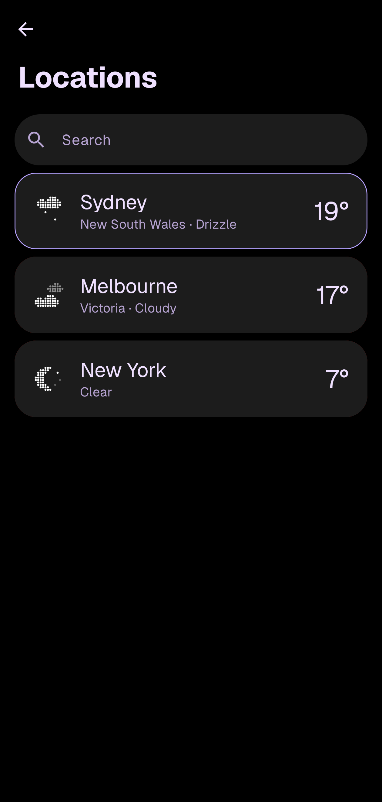
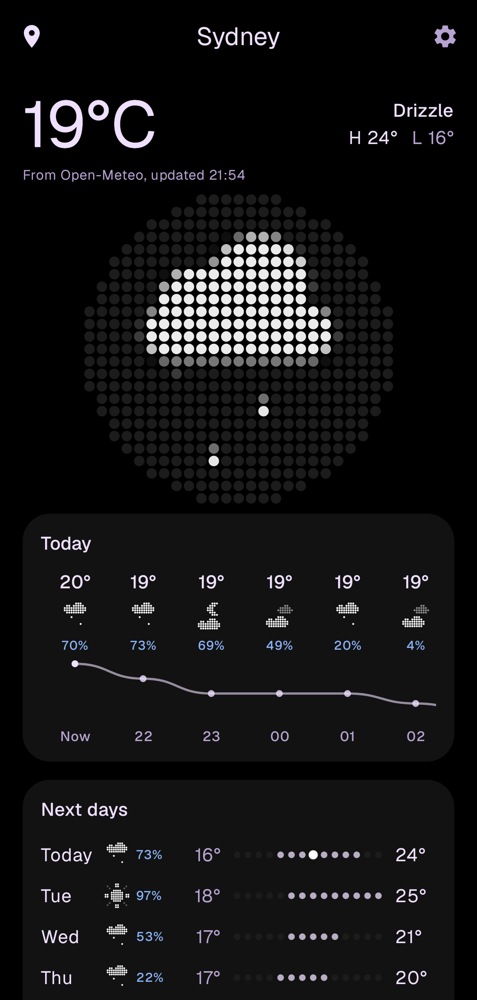
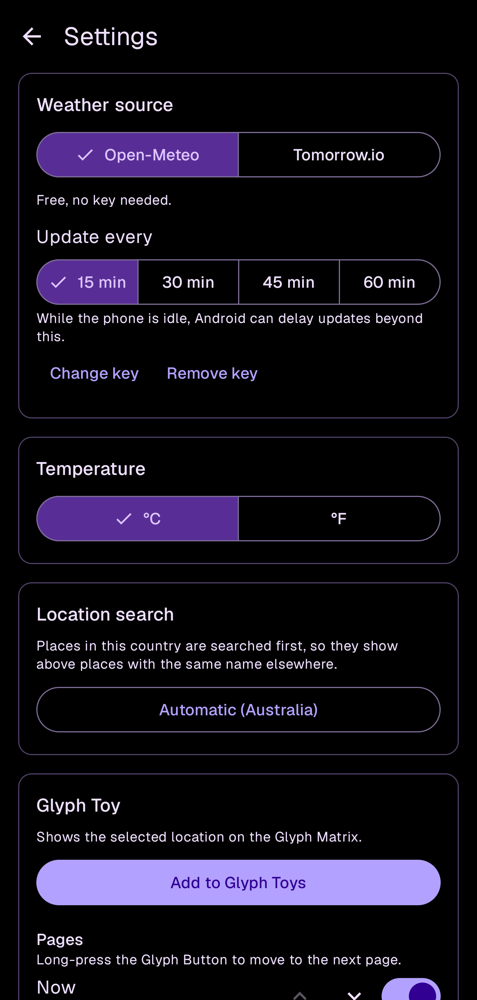

# Glyph Weather

A weather Glyph Toy for the Nothing Phone (3). It shows the weather on the 25×25 Glyph Matrix
on the back of the phone, across four pages:

- **Now**: a weather icon and the current temperature
- **Animation**: a full-size animated weather icon
- **High / low**: today's high above, low below
- **Rain**: chance of rain for each of the next 12 hours

Long-press the Glyph Button to move to the next page.

Weather data comes from [Open-Meteo](https://open-meteo.com/), which needs no API key and
publishes its data under CC BY 4.0. With your own API key the app can use
[Tomorrow.io](https://www.tomorrow.io/) instead; see [Weather sources](#weather-sources).

The weather icons are Nothing's own: the widget animations from the Nothing Weather app,
converted for the 25×25 matrix. The app can switch to the original pixel-art icons instead,
which are drawn in code in the `icons` module.

## Using it

1. Open **Glyph Weather**, tap the pin at the top left and search for your city.
2. Tap the gear at the top right, then **Add to Glyph Toys**, and add **Weather** to your toys.
3. Press the Glyph Button until Weather is selected.

The app has three pages. The middle one shows the selected city: the current temperature and
condition, today's high and low, the weather icon as it appears on the Glyph Matrix, the coming
hours with a temperature line, and the next 5 to 7 days. Pull down to refresh.

<table>
  <tr>
    <td></td>
    <td></td>
    <td></td>
  </tr>
  <tr>
    <td align="center">Locations</td>
    <td align="center">Weather</td>
    <td align="center">Settings</td>
  </tr>
</table>

Shown with the original icons and Open-Meteo.

The pin opens **Locations**: every city you've searched for, each with its current temperature
and condition. Tap one to select it, swipe one left to remove it, or hold one for 1 second to
reorder the list. The Glyph Toy always shows the selected city. Search puts places in your
country first (the phone's country, or the one set under **Location search** in Settings),
then places in the states of cities you've saved, then bigger places. Typing a state or
country after a comma, as in "Epping, New South Wales", narrows the results.

The gear opens **Settings**: the weather source and how often it updates, °C or °F, the search
country, the Glyph Toy's pages, Nothing's or the original icons, and animation, separately for
normal use and for the always-on display (set in Settings → Glyph Interface → Flip to Glyph → Always-on Glyph Toy).

With Nothing's icons, the animation plays once when the page appears or the screen turns on,
then stays on its last frame. At 40 °C and above the Animation page shows Nothing's extreme heat
animation instead of the condition, and at −10 °C and below the extreme cold one.

The selected city's forecast refreshes every 15, 30, 45 or 60 minutes (30 by default), set
under **Weather source**. While the phone is idle, Android can delay a refresh beyond that.
Every other saved city is refreshed once a day, one request each, so the Locations page costs
nothing extra to open. The only data sent anywhere is the city names you search for, which go to
Open-Meteo, and your saved cities' coordinates, which go to the selected weather source.

## Weather sources

The app uses one source at a time. Every page shows data from that source alone: switching
sources deletes the cached forecast, and a forecast saved from another source or another city
is never shown. City search always uses Open-Meteo, because it only turns a name into
coordinates and a time zone.

**Open-Meteo** is the default. It needs no account. Each refresh is one request for the
current conditions, today's high and low, and 7 days of hourly temperature, weather, chance of
rain and wind.

**Tomorrow.io** needs a free account and its API key, entered under **Weather source** in the
app. The app checks the key with one forecast request before saving it. The key is stored in
its own file on the phone, left out of Android backups and device transfers, and only sent to
Tomorrow.io.

- Each refresh is one request to Tomorrow.io's Timelines API for 4 fields (temperature,
  weather code, chance of rain and wind speed). It covers the current values plus 120 hours of
  hourly values, the most the free plan returns, which is where the 5 days on the weather page
  come from.
- Tomorrow.io's free plan allows 500 requests a day, 25 an hour and 3 a second. Refreshing
  the selected city every 15 minutes uses about 96 a day; every 60 minutes, about 24. Each
  other saved city adds 1 a day. Tomorrow.io counts each request once, not once per field.
- Today's high and low come from those hourly temperatures, in the city's own time zone, not
  from Tomorrow.io's daily forecast. Hours already past aren't in a new forecast, so the app
  keeps each hour's temperature from earlier refreshes the same day. The first refresh of a
  day only covers the hours from then until midnight.
- Tomorrow.io's current conditions don't say whether it's day or night, so the app works it
  out from the sun's position at the city's coordinates.

If Tomorrow.io rejects the key or the rate limit is reached, the app keeps showing the last
forecast and says what went wrong in the Weather section. It doesn't fall back to Open-Meteo.

## Where Nothing's animations come from

The Nothing Weather app (version 3.4.5) keeps its widget animations in `res/raw/` as JSON files,
such as `widget_clearday_initial.json`. Each file is a grid of dots, 24 to 32 dots wide, and each
frame lists the lit dots as `"radius:brightness"`. Every dot has the same radius, so the picture
is in the brightness, 0 to 255. Frames are 16 ms apart. An animation moves for 0.7 seconds (clear
night) to 3.3 seconds (snow), then ends on a still image.

`nothing-art/tools/convert.py` converts 13 of them into the files in
`nothing-art/src/main/resources/nothing-art/`:

- Each animation is centred on its last frame. Earlier frames reach further out (rain falls in
  from above), and centring on all frames put some icons 1 to 2 LEDs off centre.
- `full/` holds the Animation page versions, scaled 1.65× to 2.26× with area averaging so each
  fills the round matrix without clipping any frame.
- `small/` holds the Now page versions: one dot per LED, in the 12×12 square above the
  temperature.
- Every 6 source frames are averaged into one 96 ms frame. On a Phone (3) this looked better
  than the same conversion at 30 fps.
- Leading blank frames are dropped, and brightness is scaled so the brightest dot is 255.

Drizzle and rain both use `rainy`. The app doesn't use `cloudy`, `hazysunshine` or
`hazynight`.

To convert them again from the app on a connected phone:

```sh
adb shell pm path com.nothing.weather     # prints the path of base.apk
adb pull <path of base.apk> nothing-weather.apk
unzip nothing-weather.apk 'res/raw/*_initial.json' -d nothing-weather
python3 nothing-art/tools/convert.py nothing-weather/res/raw nothing-art/src/main/resources/nothing-art
```

## Verifying a download

APKs on the [Releases](https://github.com/AalmanSadath/GlyphWeather/releases) page are built by
GitHub Actions and signed with a key whose SHA-256 certificate fingerprint is:

```
4363d984708d3e0c12d32d17ce01be637031dbe74102af2a8a147c23eee91913
```

Check a download against it with `apksigner` from the Android SDK build tools:

```sh
apksigner verify --print-certs GlyphWeather-v0.1.0.apk
```

Each release also has a `.sha256` file; `sha256sum -c GlyphWeather-v0.1.0.apk.sha256` checks
the APK was not corrupted in transit.

## Building

Requirements: JDK 17 or newer and the Android SDK (platform 36).

```sh
./gradlew :app:assembleDebug
```

The first build downloads Nothing's Glyph Matrix SDK into `app/libs/` from Nothing's GitHub
repository, pinned to a known commit and checked against a SHA-256 hash. The SDK's license
does not allow redistribution, so it is not committed here.

### Tests

```sh
./gradlew :icons:test :weather:test :nothing-art:test
```

`OPEN_METEO_LIVE=1 ./gradlew :weather:test` also runs one test against the real Open-Meteo
API.

### Previewing icons and pages

```sh
./gradlew :icons:preview
```

renders every icon and page as animated GIFs and contact sheets into
`icons/build/icon-preview/`.

`./gradlew :icons:appIcons` redraws the launcher icon and the Glyph Toys preview from the
clear-day icon, following Nothing's Phone (3) Glyph preview image specification.

Debug builds also include an icon tester: an app ("Glyph Weather icon test") that shows any
icon or page on the matrix, and a Glyph Toy ("[Debug] Icon tester") that steps through them
with a long press. Neither is in release builds.

## Project layout

| Module | What's in it |
|---|---|
| `icons` | Pure Kotlin: the LED mask, icons, pixel font and page layouts. No Android dependencies, so it runs in JVM tests and the preview renderer. |
| `weather` | Pure Kotlin: the Open-Meteo and Tomorrow.io clients, weather-code mapping and page rendering. |
| `nothing-art` | Nothing's converted weather animations, the code that loads them, and the converter script. The animations are not under the GPL; see `nothing-art/NOTICE.md`. |
| `app` | The Android app: settings screen, Glyph Toy service, background refresh, and the connection to the Glyph Matrix. |

## License

GPL-3.0 (see `LICENSE`), with an additional permission to link against Nothing's proprietary
Glyph Matrix SDK (see `LICENSE-EXCEPTION.md`).

The weather animations in `nothing-art/src/main/resources/nothing-art/` are © Nothing
Technology Limited and are not covered by the GPL. They are included without Nothing's explicit
permission and will be removed if Nothing asks. Deleting that folder leaves the app on its
original icons. See `nothing-art/NOTICE.md`.
